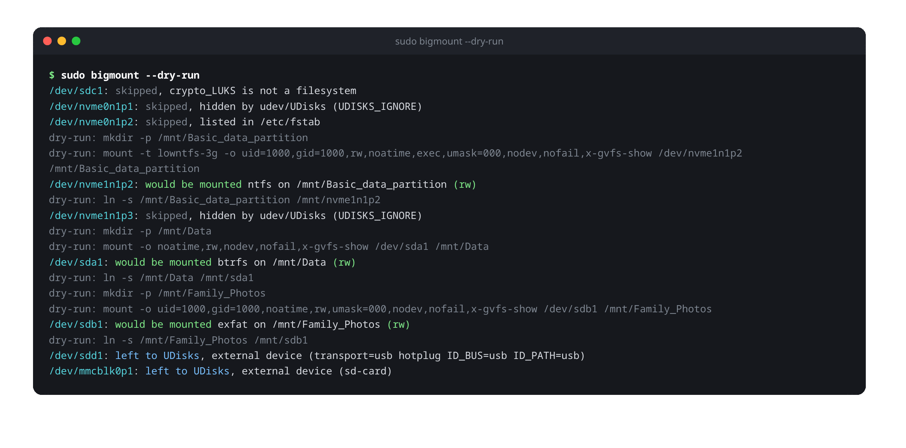
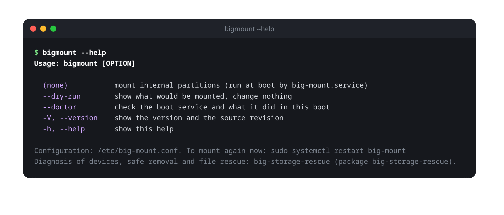
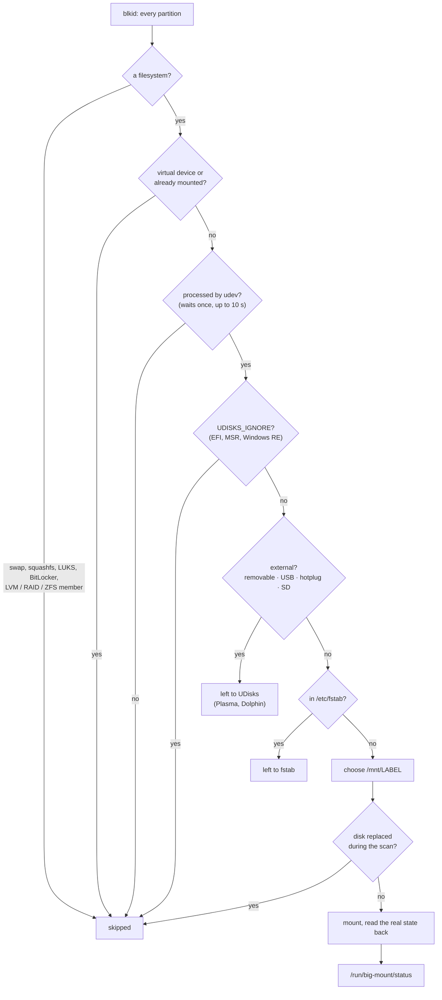
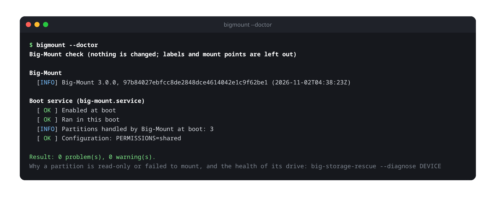
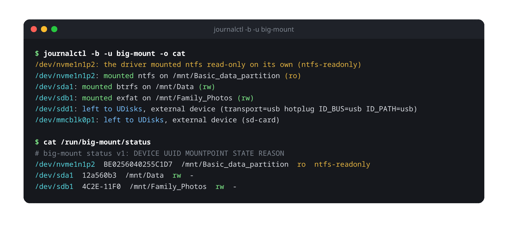
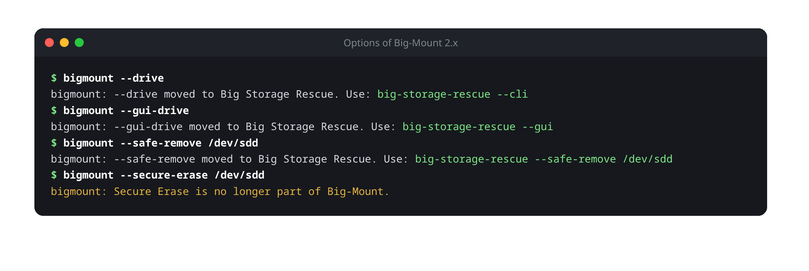
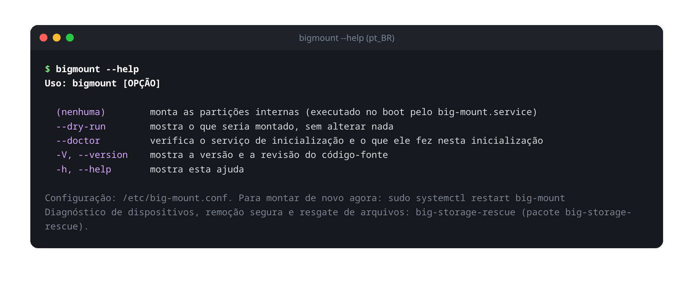

<div align="center">

# Big-Mount

**Your internal disks, mounted at every boot, the moment the system starts.**

Mounts the partitions of the **internal** disks under `/mnt/<label>` at boot,
so they are there for every program and service: Steam libraries, media
servers, Samba shares, backups. Removable and USB devices stay with the
desktop, and `/etc/fstab` always wins.

[](LICENSE)




[Installation](#-installation) ·
[How it works](#-how-it-works) ·
[Checking it](#-checking-it) ·
[Troubleshooting](#-troubleshooting) ·
[Configuration](#%EF%B8%8F-configuration) ·
[Upgrading from 2.x](#-upgrading-from-big-mount-2x) ·
[Development](#-development)

</div>

---

## ✨ At a glance

| | |
| --- | --- |
| **Mounts** | ext4, Btrfs, XFS, F2FS, NTFS, FAT32 and exFAT partitions of internal SATA, NVMe and eMMC disks |
| **Where** | `/mnt/<label>` (`Family Photos` → `/mnt/Family_Photos`), plus the link `/mnt/sdb1` → `/mnt/Family_Photos` |
| **When** | once at every boot, by `big-mount.service`, after the local filesystems |
| **Never touches** | USB, FireWire, Thunderbolt and SD devices · anything in `/etc/fstab` · LUKS, BitLocker, LVM and RAID members · the EFI and Windows recovery partitions · swap |
| **Windows** | hibernated or Fast Startup volumes are mounted read-only, never "fixed" (no `ntfsfix`, no deleted hiberfile) |
| **Footprint** | one bash script and its translations, about 290 KiB (33 KiB without the translations), no GUI toolkit, no Python, nothing left running |
| **Languages** | 31, from Belarusian to Traditional Chinese; any other language falls back to English |

> [!NOTE]
> Big-Mount **only mounts**. The drive manager, the diagnosis of read-only
> devices, safe removal and file rescue of Big-Mount 2.x are now a separate
> application, **[Big Storage Rescue](https://github.com/biglinux/big-storage-rescue)**
> (`sudo pacman -S big-storage-rescue`). See [Upgrading from 2.x](#-upgrading-from-big-mount-2x).

## 📦 Installation

```bash
sudo pacman -S big-mount
```

The pacman hook enables `big-mount.service`, which mounts the partitions at the
next boot. To mount them right away:

```bash
sudo systemctl start big-mount
```

### Dependencies

| Package | Used for |
| --- | --- |
| `bash` | the script itself |
| `util-linux` | `blkid`, `lsblk`, `findmnt`, `mount`, `flock` |
| `ntfs-3g` | `mount.lowntfs-3g`, for NTFS |
| `systemd` | the service, `udevadm`, and `systemctl`/`journalctl` in `--doctor` |
| `coreutils`, `glibc`, `gawk`, `sed` | `mkdir`, `ln`, `readlink`, `stat`…, `getent`, `awk`, `sed` |
| *optional:* `big-storage-rescue` | explains read-only or failed mounts, safe removal, drive health, file rescue |

FAT32, exFAT, ext4, Btrfs, XFS and F2FS are mounted by kernel drivers. Every
package above except `ntfs-3g` is already part of an Arch base system. Details:
[docs/04-dependencies.md](docs/04-dependencies.md).

### Commands



| Command | What it does | Root? |
| --- | --- | --- |
| `bigmount` | mounts the internal partitions (this is what the service runs) | yes |
| `bigmount --dry-run` | shows every decision and every command, **changes nothing** | recommended¹ |
| `bigmount --doctor` | checks the service and reports what it did at this boot, changes nothing | no |
| `bigmount --version` | version and the exact source revision of the package | no |

¹ As a normal user `blkid` may not see every partition; with `sudo` the answer is complete.

## 🔍 How it works



### Sequence of a boot run

```text
big-mount.service (Type=oneshot, After=local-fs.target, KillMode=process)
└─ /usr/bin/bigmount
   1. exits if /etc/bigmountall-no exists
   2. locks /run/lock/big-mount.lock (flock), so two runs never overlap
   3. creates the compatibility links /media -> /mnt and /mnt/user-mount -> /run/media
   4. finds the last user (SDDM, LightDM, or the first UID >= 1000), reads /etc/big-mount.conf
   5. takes one snapshot of the system:
        the diskseq of every disk, blkid, lsblk -P, /proc/mounts
   6. pass 1: drops what is not a filesystem, what is virtual and what is already mounted
   7. asks udev about every candidate in a single call (udevadm info),
      and waits for udev ONCE (udevadm settle) if a device is not processed yet
   8. pass 2, for each candidate, in blkid order:
        hidden by UDisks? external? listed in fstab? -> not mounted
        choose /mnt/<label>, check the diskseq again, mount, read the real state back
   9. writes /run/big-mount/status
```

The script ends within milliseconds (716 ms for three partitions on a real
boot, most of it in `mount`) and nothing of it stays resident. The only
processes left are the `mount.lowntfs-3g` daemons that serve NTFS volumes.

### What is never mounted

| Case | Why |
| --- | --- |
| partition in `/etc/fstab` (even `noauto`) | the administrator's explicit configuration always wins |
| already mounted | no double mounts |
| `swap`, `squashfs` | not user data |
| `crypto_LUKS`, `BitLocker`, `LVM2_member`, RAID/ZFS/bcache members, no `TYPE` | containers, not filesystems |
| `loop*`, `zram*`, `ram*`, `/dev/mapper/*`, `dm-*` | virtual devices, set up by whoever uses them |
| `UDISKS_IGNORE=1` | ESP, MSR, Windows recovery (what UDisks calls `HintIgnore`) |
| an **external** device | belongs to UDisks/Plasma (see below) |
| udev still has no information after the wait | without facts, there is no telling whether it is external |
| `diskseq` changed during the scan | the disk was replaced; the decision no longer holds |

### How an external device is recognized

Many USB hard disks and SSDs report `RM=0` ("not removable"), so the decision
combines **independent sources**. Any one of them is enough to leave the
device to UDisks:

| Source | Fact | Examples |
| --- | --- | --- |
| kernel (sysfs) | `/sys/block/X/removable = 1` | USB sticks, card readers |
| kernel (`lsblk TRAN`) | `usb`, `ieee1394`, `sbp` | USB HDD/SSD with `RM=0`, docks, FireWire |
| kernel (`lsblk HOTPLUG`) | port marked removable | USB, NVMe in Thunderbolt/USB4 enclosures |
| kernel (sysfs) | `device/type = SD` | SD card in an internal reader (`MMC` is soldered eMMC: internal) |
| udev | `ID_BUS=usb`/`ieee1394`, `ID_PATH` containing `-usb-` | the same information, seen by udev |
| udev | `ID_DRIVE_FLASH_SD=1`, `ID_DRIVE_MEDIA_FLASH_SD=1` | SD cards |
| udev | `UDISKS_SYSTEM=0` | an administrator's rule, e.g. for eSATA bays ([see below](#esata-bays-and-other-special-cases)) |

The reasons are printed by `--dry-run` and in the journal, for example
`left to UDisks, external device (transport=usb hotplug ID_BUS=usb ID_PATH=usb)`.

### Mount point name

1. The filesystem `LABEL`; without one, the `PARTLABEL` (GPT partition
   name); without both, the device name (`sdb3`).
2. Spaces, `/` and control characters become `_`. Accents and Unicode are
   kept (`Family Photos` → `/mnt/Family_Photos`).
3. `.` and `..` are rejected (`..` would mount over `/`), and so are labels
   longer than 200 bytes. In both cases the device name is used.
4. If `/mnt/<name>` is used by **another** device, a number is added:
   `Data1`, `Data2`... Empty directories and stale links are reused.
5. The link `/mnt/<device>` → `/mnt/<label>` is created (`/mnt/sda1` →
   `/mnt/Data`). An old link pointing elsewhere, for example after the disks
   changed order, is updated. A real directory or file at that path is never
   touched.

The label comes from the device and is untrusted: it never goes through
`eval`, `echo` or a shell.

### Mount options

| Filesystem | Command |
| --- | --- |
| NTFS | `mount -t lowntfs-3g -o uid=U,gid=G,rw,noatime,exec,MASK,nodev,nofail,x-gvfs-show` |
| FAT32, exFAT (`TYPE` containing `fat`) | `mount -o uid=U,gid=G,noatime,rw,MASK,nodev,nofail,x-gvfs-show` |
| ext4, Btrfs, XFS, F2FS and others | `mount -o noatime,rw,nodev,nofail,x-gvfs-show` |

- `U`/`G`: UID and GID of the last user who logged in.
- `MASK`: `umask=000` by default; see [`PERMISSIONS`](#etcbig-mountconf).
- `x-gvfs-show`: shows the partition in Dolphin and Nautilus.
- ext4/Btrfs/XFS keep the filesystem's own permissions.

### Windows NTFS partitions

- **No `ntfsfix`.** Older versions ran `ntfsfix` on every boot. It marks the
  volume as "needs to be checked" (the dirty bit): Windows then runs chkdsk
  at every start, and drivers such as `ntfs3` refuse to write. ntfs-3g
  recovers the journal by itself when needed.
- **Windows hibernated or with Fast Startup:** ntfs-3g mounts the volume
  read-only on its own. Big-Mount reads the real state back from
  `/proc/mounts` and records the reason, which `big-storage-rescue --diagnose`
  explains. ntfs-3g versions that refuse instead (exit codes 13, 14 and 15 of
  `ntfs-3g.probe(8)`) are retried with `ro`. `remove_hiberfile`, which would
  delete the Windows session, is never used.
- To write again, shut Windows down completely (Shift + Shut down) or
  disable Fast Startup.

### The systemd service

```ini
[Unit]
Description=BigLinux automount internal partitions
After=local-fs.target
RequiresMountsFor=/mnt

[Service]
Type=oneshot
RemainAfterExit=yes
ExecStart=/usr/bin/bigmount
KillMode=process
```

`KillMode=process` matters: the NTFS FUSE daemon (`mount.lowntfs-3g`) is
started inside the service. With the default `control-group`, a `systemctl
restart big-mount` killed it and the volume vanished under the programs
using it.

## 🩺 Checking it

### `bigmount --doctor`

Is the service enabled, did it run at this boot, did anything fail or end up
read-only, is the installation intact? It changes nothing, needs no root, and
leaves labels and mount points out of the report, so it can be pasted in a
forum or a bug report as it is.



It exits with `0` when no problem was found and `1` otherwise.

### The journal and the status file



```bash
journalctl -b -u big-mount             # what happened during this boot
journalctl -b -u big-mount -p warning  # warnings and errors only
systemd-analyze blame | grep big-mount # how long it took
```

On a terminal the messages follow your language; in the journal they stay in
English, so they can be searched for and quoted in bug reports.

`/run/big-mount/status` (root, 0644, cleared at every boot) has one line per
mount made at boot, separated by tabs. It is read by `bigmount --doctor` and by
Big Storage Rescue.

| `STATE` | Possible `REASON` |
| --- | --- |
| `rw` | `-` |
| `ro` | `ntfs-readonly`, `ntfs-hibernated`, `ntfs-inconsistent`, `ntfs-unclean`, `readonly-fallback` |
| `failed` | the NTFS reasons, or `mount-exit-N` |

## 🛠 Troubleshooting

| Symptom | What to do |
| --- | --- |
| A partition is not mounted | `sudo bigmount --dry-run` prints why for every partition. `skipped, listed in /etc/fstab` means fstab owns it; `left to UDisks` means it looks external |
| An internal disk is treated as external | usually an eSATA bay or a dock: see [eSATA bays](#esata-bays-and-other-special-cases). The reason in parentheses says which fact decided it |
| A Windows partition is read-only | Windows is hibernated or uses Fast Startup: shut it down with Shift + Shut down, or disable Fast Startup. `big-storage-rescue --diagnose /dev/sdXN` gives the full explanation |
| `mount … failed (exit 32)` | the filesystem needs a check (`fsck`, or `chkdsk` on Windows), or its driver is missing. `journalctl -b -u big-mount` has the message of `mount` |
| Other users cannot write to a FAT/NTFS partition, or can and should not | set [`PERMISSIONS`](#etcbig-mountconf) |
| I want another mount point or other options | put the partition in `/etc/fstab`; Big-Mount steps aside |
| I do not want Big-Mount at all | `sudo touch /etc/bigmountall-no`, see [below](#disable-the-automatic-mounting) |
| `bigmount: mounting the internal partitions needs administrator rights` | mounting is the job of the service: `sudo systemctl restart big-mount` |

When asking for help, attach the output of `bigmount --doctor` and
`sudo bigmount --dry-run`.

## ⚙️ Configuration

### `/etc/big-mount.conf`

```ini
# Who may write to INTERNAL FAT, exFAT and NTFS partitions mounted under /mnt
PERMISSIONS=shared
```

| Value | Mount options | Effect |
| --- | --- | --- |
| `shared` (default) | `umask=000` | every local account reads, writes and runs files: the behavior of every previous version |
| `owner` | `dmask=022,fmask=022` | only the last user who logged in writes; everyone reads (running programs stays allowed, for Wine/Steam) |
| `private` | `umask=077` | only the last user who logged in has access |

- Applies to internal FAT/exFAT/NTFS. ext4, Btrfs, XFS, etc. keep their own
  permissions.
- The file is parsed as data, never executed. An unknown value is reported
  in the journal and `shared` is used.
- It is kept on package updates (`backup=` in the PKGBUILD).
- Apply without rebooting: `sudo systemctl restart big-mount`. Partitions
  that are already mounted keep their options until they are mounted again.

### Disable the automatic mounting

```bash
sudo touch /etc/bigmountall-no      # disable
sudo rm /etc/bigmountall-no         # enable again
```

### eSATA bays and other special cases

The kernel does not mark eSATA ports as removable. For Big-Mount (and
UDisks) to treat an eSATA disk as external, add a udev rule:

```bash
# find the path of the disk
udevadm info --query=property --name=/dev/sdX | grep ID_PATH=

sudo tee /etc/udev/rules.d/99-esata.rules <<'EOF'
ENV{ID_PATH}=="pci-0000:00:17.0-ata-5*", ENV{UDISKS_SYSTEM}="0"
EOF
sudo udevadm control --reload && sudo udevadm trigger
```

To **prevent** an internal partition from being mounted, either put it in
`/etc/fstab` with `noauto`, or hide it entirely with
`ENV{UDISKS_IGNORE}="1"`.

To mount a partition somewhere else or with other options, put it in
`/etc/fstab`. Big-Mount never touches partitions listed there.

## 🔄 Upgrading from Big-Mount 2.x

Big-Mount 3.0 keeps the boot run of 2.x unchanged (only comments differ) and
removes everything else. The update keeps `/etc/big-mount.conf` and the
enabled service; the next boot behaves exactly as before.

```bash
sudo pacman -Syu                     # big-mount 3.0
sudo pacman -S big-storage-rescue    # the drive manager, diagnosis, safe removal and rescue
```

The options of 2.x still answer, with the command that does the same now
(exit code 2), so scripts and habits fail loudly instead of silently:



| 2.x | Now |
| --- | --- |
| `bigmount --drive …` | `big-storage-rescue --cli …` |
| `bigmount --gui-drive`, `--gui-drive-check` | `big-storage-rescue --gui`, `--gui-health` |
| `bigmount --gui DEV` | `big-storage-rescue --gui-diagnose DEV` |
| `bigmount --diagnose`, `--busy`, `--unmount`, `--safe-remove`, `--gui-remove` | `big-storage-rescue` with the same option |
| `bigmount --secure-erase` | not available any more |
| `bigmount --notifier` (old autostart entries) | does nothing, quietly |

> [!IMPORTANT]
> **Let copies and disk images of the 2.x drive manager finish before you
> update.** A job that is already running goes on after the update, but the
> files that manage it are removed with 2.x; Big Storage Rescue picks it up
> when it ends. The package warns about running jobs during the update.

## 🗑 Uninstalling

```bash
sudo systemctl disable big-mount
sudo pacman -R big-mount
```

Partitions mounted at this boot stay mounted until the next shutdown. The
compatibility links `/media` and `/mnt/user-mount` and the folders under `/mnt`
are left in place: remove them by hand if nothing else uses them.

## 🌐 Translations

Every message shown on a terminal follows the system language (`LANGUAGE`,
`LC_ALL`, `LC_MESSAGES`, `LANG`); boot messages stay in English in the
journal. A language or a message without translation falls back to English.



| | |
| --- | --- |
| **Included (31)** | Belarusian `be` · Bulgarian `bg` · Chinese, Simplified `zh_CN` · Chinese, Traditional `zh_TW` · Croatian `hr` · Czech `cs` · Danish `da` · Dutch `nl` · English `en` · Estonian `et` · Finnish `fi` · French `fr` · German `de` · Greek `el` · Hebrew `he` · Hungarian `hu` · Icelandic `is` · Italian `it` · Japanese `ja` · Korean `ko` · Norwegian Bokmål `nb` · Polish `pl` · Portuguese `pt` · Portuguese, Brazil `pt_BR` · Romanian `ro` · Russian `ru` · Slovak `sk` · Swedish `sv` · Turkish `tr` · Ukrainian `uk` |
| **Columns** | tables are aligned by terminal columns, so accents and CJK text line up |

```text
locale/
├── big-mount.pot     template with every message
├── <lang>.po         one catalog per language
├── LINGUAS           languages to build
├── update-pot.sh     extracts the messages and merges them into every .po
└── compile.sh        builds big-mount/usr/share/locale/<lang>/LC_MESSAGES/big-mount.mo
```

To add a language, for example Catalan:

```bash
msginit --no-translator -l ca -i locale/big-mount.pot -o locale/ca.po
echo ca >> locale/LINGUAS
# translate locale/ca.po
bash locale/compile.sh
bash tests/i18n-tests.sh
```

After changing a message in the code:

```bash
bash locale/update-pot.sh   # new entries appear untranslated, changed ones as fuzzy
# review every fuzzy entry: msgmerge's guesses are usually wrong
bash locale/compile.sh
bash tests/i18n-tests.sh    # fails on untranslated, fuzzy or mismatched %s/%d
```

Keep data out of the format: `printf $"%s: mounted %s on %s (%s)" "$DEV" …`,
never a variable inside `$"..."`.

## 🧪 Development

```bash
bash tests/run-tests.sh new     # the boot run against stubbed devices
bash tests/i18n-tests.sh        # translations
bash tests/package-check.sh     # package() on this checkout
bash tests/bench.sh big-mount/usr/bin/bigmount   # the boot run on the real devices, mount stubbed
tests/manual-check.sh           # after a real boot with the package installed
```

None of the suites touches a disk: every tool that could is replaced by a stub
in `tests/stubs/`, and the harness refuses to run if one of them resolves to
the real program. CI runs ShellCheck and the three suites on Arch Linux for
every pull request.

To try a change on your machine without installing it:

```bash
sudo big-mount/usr/bin/bigmount --dry-run
```

### Project layout

```text
big-mount/                       what the package installs
├── etc/big-mount.conf           configuration
└── usr/
    ├── bin/bigmount             the boot run (the only code loaded at boot)
    ├── lib/big-mount/cli.sh     --help, --version, --doctor, the 2.x options
    ├── lib/systemd/system/      big-mount.service
    └── share/libalpm/hooks/     enables the service on install
pkgbuild/                        PKGBUILD and install messages
locale/                          translations
tests/                           test suites and device stubs
docs/                            design notes (01–07) and the history of 2.x
```

Technical notes: [docs/](docs) (01–07). The history of 2.x, including the
reasons behind the device detection, is in [docs/history](docs/history).

## 📄 License

[GNU General Public License v3.0 or later](LICENSE).
